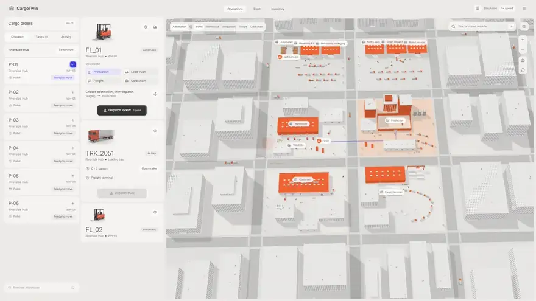
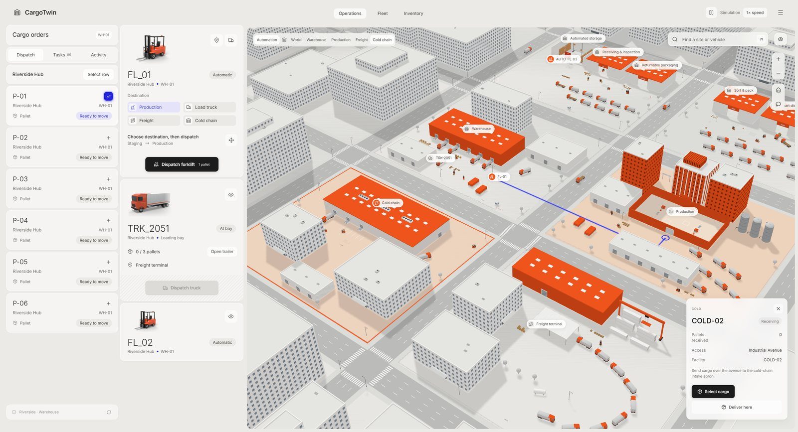
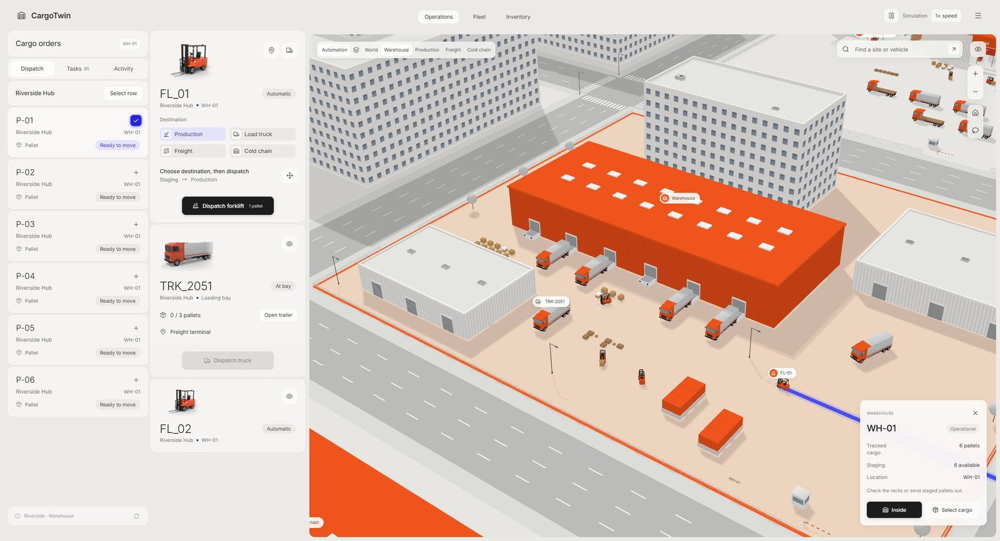
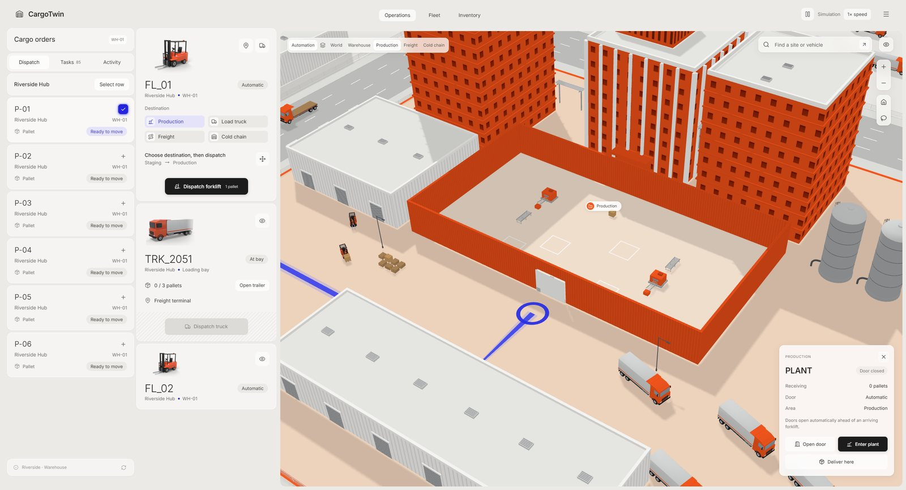
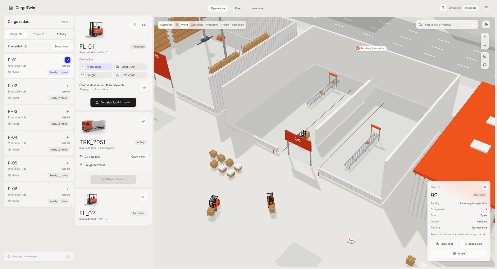
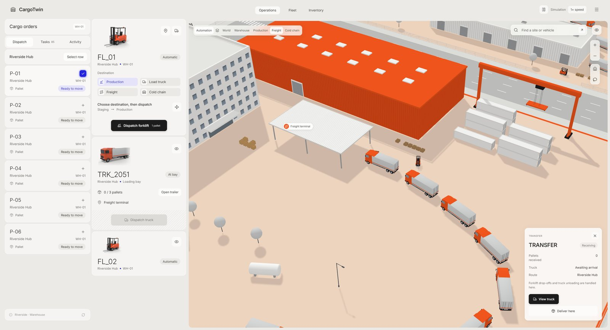
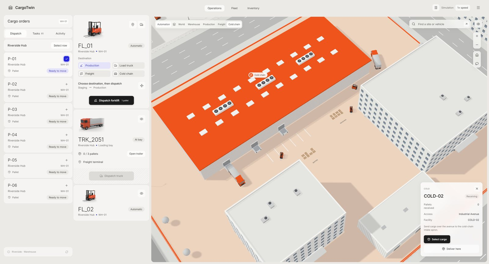
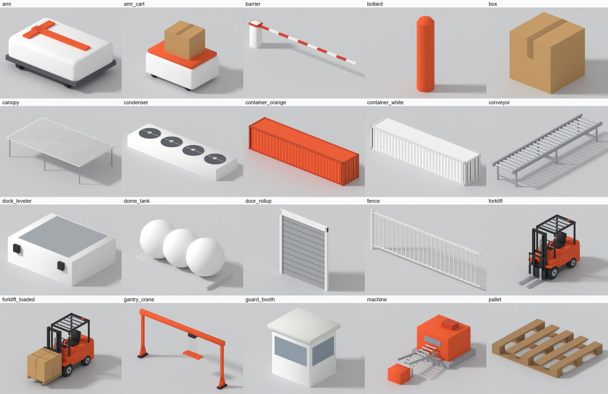
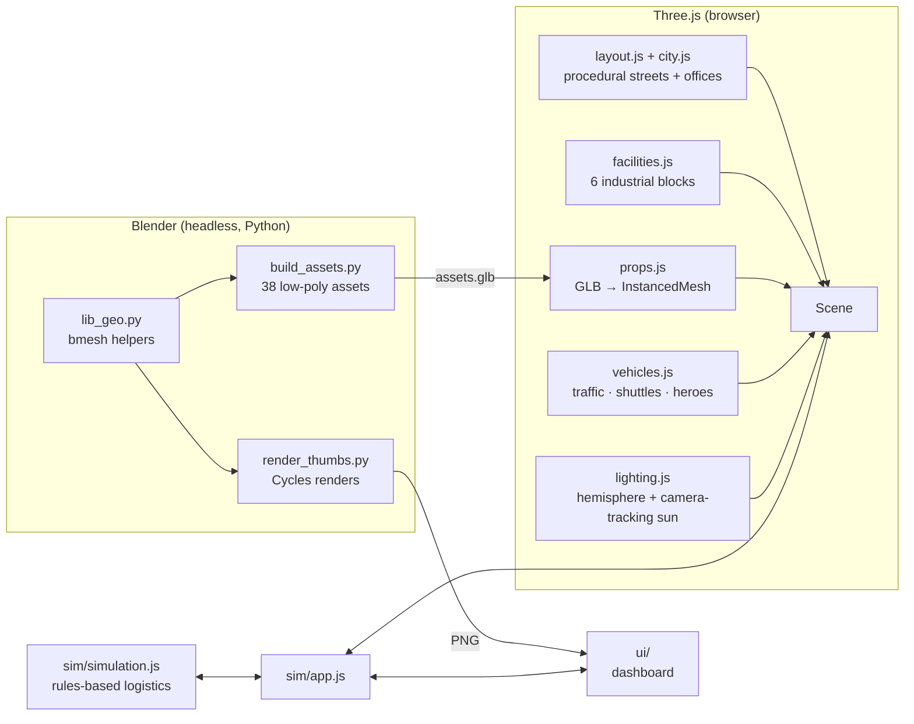

<div align="center">


# CargoTwin

**A real-time 3D logistics digital twin that runs in your browser.**

A white low-poly city, orange warehouses, and forklifts and trucks you can dispatch.<br/>
Built with Three.js. Vehicles and props are modelled by Blender Python scripts and the city is generated procedurally, so there are no downloaded assets.

[](https://wangzh12023.github.io/cargotwin/)
[](https://github.com/wangzh12023/cargotwin/actions/workflows/deploy.yml)

[](https://threejs.org)
[](https://vite.dev)
[](https://www.blender.org)
[](#)
[](#)
[](LICENSE)
[](#-contributing)
[](https://github.com/wangzh12023/cargotwin/stargazers)

**English** · [简体中文](README.zh-CN.md)

<a href="https://wangzh12023.github.io/cargotwin/"></a>

<sub>Real capture from the running app (4× sim speed). <a href="docs/media/demo.mp4">HD MP4</a></sub>

</div>

---

## ✨ Features

| | |
|---|---|
| 🏙️ **A full 3D city** | A 10 × 11 block street grid with lane markings, crosswalks, and procedurally generated office blocks. An industrial district of six themed blocks sits in the middle. |
| 🏭 **Six facilities** | WH-01 warehouse, a production plant with three orange towers and silos, a COLD-02 cold-chain store, a freight terminal with a gantry crane, plus storage (ASRS) and QC sheds. |
| 🚜 **Live simulation** | Select pallets, pick a destination, then click **Dispatch forklift**. FL-01 picks up the load, drives the route, and the plant door rolls up for it. You can also load TRK-2051 and send it across town. |
| 🎥 **Cinematic camera** | Eased fly-to transitions between layers (World / Warehouse / Production / Freight / Cold chain), a follow-cam, and map-style pan, orbit and zoom. |
| 🧊 **Blender pipeline in code** | `blender/*.py` builds 38 low-poly assets (trucks, forklifts, silos, cranes, racks…) and renders the UI thumbnails with Cycles, fully headless. |
| ⚡ **Fast** | Assets are drawn with GPU instancing (about 1.1 M triangles per frame), and the shadow frustum follows the camera. 60 fps on a laptop GPU, and quality drops automatically on slower machines. |
| 🪟 **Dashboard UI** | A frosted-glass control room in vanilla JS: cargo orders, a fleet panel, a layer bar, search, info panels and 3D-anchored labels. |
| 📦 **Tiny & static** | About 193 KB of gzipped JS plus a 684 KB GLB, no backend. It deploys anywhere: GitHub Pages, Vercel, Netlify or a USB stick. |

## 🚀 Quick start

```bash
git clone https://github.com/wangzh12023/cargotwin.git
cd cargotwin
npm install
npm run dev        # → http://localhost:5173
```

Requires [Node.js](https://nodejs.org) **20.19+ or 22.12+** (any current LTS works). That's it. The 3D assets are prebuilt in `public/`, so **you don't need Blender** unless you want to change the models.

## 🌐 Deploy your own copy (1 minute, no terminal)

### Option A: GitHub Pages (free)

1. Click **[Fork](https://github.com/wangzh12023/cargotwin/fork)** (top right).
2. In your fork, open **Settings → Pages** and set **Source** to **GitHub Actions**.
3. Open the **Actions** tab, enable workflows if GitHub asks, select **Deploy to GitHub Pages**, and click **Run workflow**.

Your site will be live at `https://<your-name>.github.io/cargotwin/` 🎉. Every push to `main` redeploys automatically.

### Option B: One click on Vercel or Netlify

[](https://vercel.com/new/clone?repository-url=https%3A%2F%2Fgithub.com%2Fwangzh12023%2Fcargotwin)
[](https://app.netlify.com/start/deploy?repository=https://github.com/wangzh12023/cargotwin)

### Option C: Any static host

```bash
npm run build      # outputs dist/, upload it anywhere (relative paths, works from any sub-folder)
```

## 🎮 Controls

| Action | Mouse | Touch |
|---|---|---|
| Pan | Left-drag | One finger |
| Orbit / tilt | Right-drag (or toggle the lasso tool) | Two fingers |
| Zoom | Wheel, or the **+ / −** buttons | Pinch |
| Select a facility | Click a building or its label | Tap |
| Back to overview | 🏠 button, or **World** in the layer bar | |

The search box finds sites and vehicles: try `FL-01`, `cold` or `Receiving`. The 👁 button hides the labels, and the top-right controls pause the simulation or change its speed (1× / 2× / 4×).

<details>
<summary><b>🔗 URL parameters</b> (deep links, kiosk screens, screenshots)</summary>

| Parameter | Example | Effect |
|---|---|---|
| `preset` | `?preset=production` | Start at a camera preset: `world`, `warehouse`, `production`, `freight`, `cold`, `qc` |
| `panel` | `?panel=forklift` | Open an info panel: `wh`, `plant`, `transfer`, `cold`, `qc`, `forklift` |
| `demo` | `?demo` | Dispatch FL-01 to production right away |
| `bare` | `?bare` | 3D city only, no dashboard (great for a wallpaper or kiosk) |
| `nointro` | `?nointro` | Skip the opening fly-in |
| `hq` | `?hq` | Disable adaptive quality |
| `cam` | `?cam=37,39,540,-3,74` | Exact camera: `azimuth,elevation,distance,targetX,targetZ` |

</details>

## 🖼️ Gallery

| World | Warehouse WH-01 |
|---|---|
|  |  |
| **Production plant** | **Receiving & inspection (roof hidden)** |
|  |  |
| **Freight terminal** | **Cold chain COLD-02** |
|  |  |

<details>
<summary><b>🧊 All 38 Blender-generated assets</b></summary>



</details>

## 🧱 How it's made



- **No textures to download.** Window grids, corrugated metal, roll-up doors and signage are drawn at runtime on `<canvas>`.
- **Clay look.** Everything uses matte Lambert materials with a strong hemisphere fill and a sun from behind the viewer, which gives bright roofs, soft walls and long readable shadows.
- **One GLB, a few hundred draw calls.** Every `(asset, material)` pair becomes a single `InstancedMesh`, whether it's 9 trucks or 900 fence segments.

More detail in [docs/ARCHITECTURE.md](docs/ARCHITECTURE.md).

## 🛠️ Rebuild the 3D models (optional)

Install [Blender](https://www.blender.org/download/) (tested with 5.2), then run:

```bash
npm run assets     # finds Blender automatically, or set BLENDER_PATH=/path/to/blender
```

This regenerates `public/models/assets.glb` and `public/img/*.png`. Tweak sizes, colours or shapes in `blender/build_assets.py` and run it again.

## 📁 Project structure

```
blender/        Blender Python: models (build_assets.py) + thumbnails (render_thumbs.py)
public/         prebuilt assets.glb, thumbnails, favicon
src/world/      Three.js scene: layout, city, facilities, props, vehicles, lighting, camera
src/sim/        logistics simulation + glue between UI, world and sim
src/ui/         vanilla-JS dashboard (top bar, sidebar, panels, labels)
scripts/        build-assets.mjs (runs Blender headlessly)
```

## 🤝 Contributing

Issues and PRs are welcome. Ideas: new facilities, day/night lighting, more vehicle types, real data feeds over WebSocket, or better touch gestures. Run `npm run build` before opening a PR.

## 📄 License

[MIT](LICENSE). Use it, fork it, ship it.

## 🙏 Acknowledgements

[Three.js](https://threejs.org) · [Blender](https://www.blender.org) · [Vite](https://vite.dev) · [Lucide](https://lucide.dev) icons · [Inter](https://rsms.me/inter/) typeface.
The visual direction was inspired by a logistics digital-twin concept seen in a short video. All code, models and textures in this repository are original.

## ⭐ Star History

<a href="https://star-history.com/#wangzh12023/cargotwin&Date">
  <picture>
    <source media="(prefers-color-scheme: dark)" srcset="https://api.star-history.com/svg?repos=wangzh12023/cargotwin&type=Date&theme=dark" />
    <source media="(prefers-color-scheme: light)" srcset="https://api.star-history.com/svg?repos=wangzh12023/cargotwin&type=Date" />
    
  </picture>
</a>

<div align="center"><sub>If you like it, a ⭐ helps others find it!</sub></div>
