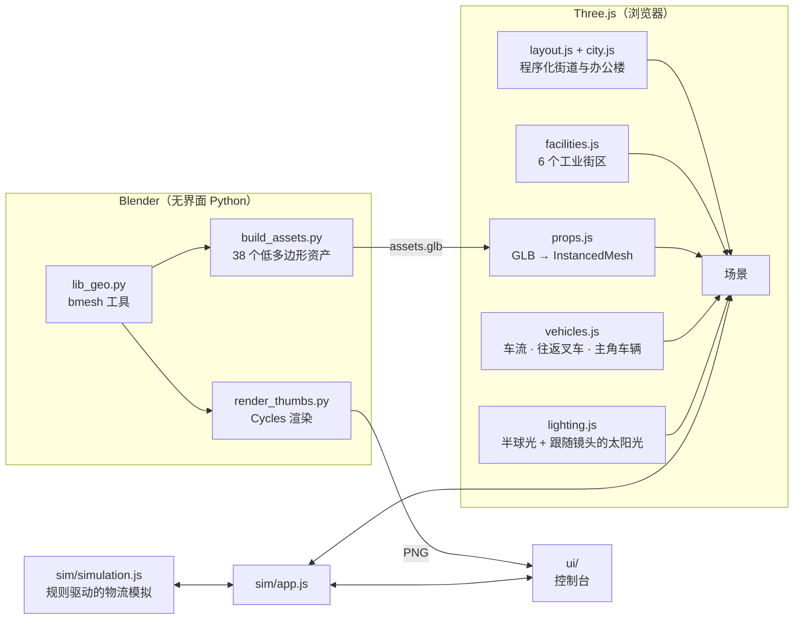

<div align="center">


# CargoTwin

**在浏览器里实时运行的 3D 物流数字孪生城市。**

白色低多边形城市、橙色仓库，还有可以亲手调度的叉车和卡车。<br/>
基于 Three.js 构建：车辆和道具由 Blender Python 脚本建模，城市本身由程序生成，没有任何下载素材。

[](https://wangzh12023.github.io/cargotwin/)
[](https://github.com/wangzh12023/cargotwin/actions/workflows/deploy.yml)

[](https://threejs.org)
[](https://vite.dev)
[](https://www.blender.org)
[](#)
[](#)
[](LICENSE)
[](#-参与贡献)
[](https://github.com/wangzh12023/cargotwin/stargazers)

[English](README.md) · **简体中文**

<a href="https://wangzh12023.github.io/cargotwin/"></a>

<sub>运行中的应用实录（4 倍模拟速度）· <a href="docs/media/demo.mp4">高清 MP4</a></sub>

</div>

---

## ✨ 功能亮点

| | |
|---|---|
| 🏙️ **完整的 3D 城市** | 10 × 11 个街区的道路网，带车道线和斑马线，办公楼按规则自动生成。城市中央是由六个主题街区组成的工业区。 |
| 🏭 **六大设施** | WH-01 仓库、带三座橙色塔楼和筒仓的生产厂、COLD-02 冷链库、带龙门吊的货运站，还有自动化立体库（ASRS）和质检（QC）车间。 |
| 🚜 **实时模拟** | 勾选托盘、选好目的地，再点 **Dispatch forklift**。FL-01 会取货并沿路线行驶，到厂区时卷帘门会自动升起。你还可以给 TRK-2051 装货，让它开到城市另一头。 |
| 🎥 **电影感镜头** | 图层（World / Warehouse / Production / Freight / Cold chain）之间平滑飞行过渡，支持跟随镜头，以及地图式的平移、旋转和缩放。 |
| 🧊 **代码化的 Blender 管线** | `blender/*.py` 在无界面模式下生成 38 个低多边形资产（卡车、叉车、筒仓、龙门吊、货架……），并用 Cycles 渲染出 UI 里的缩略图。 |
| ⚡ **高性能** | 资产用 GPU 实例化绘制（每帧约 110 万三角形），阴影范围跟随镜头。笔记本独显可以跑满 60 fps，较慢的设备会自动降低画质。 |
| 🪟 **控制台 UI** | 用原生 JS 写的毛玻璃风格控制室：货单、车队面板、图层栏、搜索、信息面板，以及锚定在 3D 场景里的标签。 |
| 📦 **轻量、纯静态** | 约 193 KB 的 gzip JS，加一个 684 KB 的 GLB，不需要后端。可以部署在 GitHub Pages、Vercel、Netlify，甚至 U 盘上。 |

## 🚀 本地运行

```bash
git clone https://github.com/wangzh12023/cargotwin.git
cd cargotwin
npm install
npm run dev        # 打开 http://localhost:5173
```

需要 [Node.js](https://nodejs.org) **20.19+ 或 22.12+**（当前任意 LTS 版本都可以），三条命令就能跑起来。3D 资产已经预先构建在 `public/` 里，**不需要安装 Blender**，除非你想修改模型。

## 🌐 部署自己的版本（1 分钟，不用开终端）

### 方式 A：GitHub Pages（免费）

1. 点右上角的 **[Fork](https://github.com/wangzh12023/cargotwin/fork)**。
2. 在你 fork 出来的仓库里打开 **Settings → Pages**，把 **Source** 设为 **GitHub Actions**。
3. 打开 **Actions** 标签页（如果 GitHub 提示，先点按钮启用 workflows），选择 **Deploy to GitHub Pages**，然后点 **Run workflow**。

网站会发布在 `https://<你的用户名>.github.io/cargotwin/` 🎉。之后每次 push 到 `main`，都会自动重新部署。

### 方式 B：Vercel / Netlify 一键部署

[](https://vercel.com/new/clone?repository-url=https%3A%2F%2Fgithub.com%2Fwangzh12023%2Fcargotwin)
[](https://app.netlify.com/start/deploy?repository=https://github.com/wangzh12023/cargotwin)

### 方式 C：任意静态托管

```bash
npm run build      # 生成 dist/，上传到任何地方都能用（相对路径，放在子目录也没问题）
```

## 🎮 操作方式

| 操作 | 鼠标 | 触屏 |
|---|---|---|
| 平移 | 左键拖动 | 单指拖动 |
| 旋转 / 俯仰 | 右键拖动（或打开套索工具） | 双指 |
| 缩放 | 滚轮，或 **+ / −** 按钮 | 双指捏合 |
| 选中设施 | 点击建筑或它的标签 | 点击 |
| 回到全景 | 🏠 按钮，或图层栏里的 **World** | |

搜索框可以查找站点和车辆，比如输入 `FL-01`、`cold` 或 `Receiving`。👁 按钮可以隐藏标签，右上角可以暂停模拟或切换速度（1× / 2× / 4×）。

<details>
<summary><b>🔗 URL 参数</b>（深链接、展示大屏、截图）</summary>

| 参数 | 示例 | 作用 |
|---|---|---|
| `preset` | `?preset=production` | 打开时停在某个镜头预设：`world`、`warehouse`、`production`、`freight`、`cold`、`qc` |
| `panel` | `?panel=forklift` | 打开某个信息面板：`wh`、`plant`、`transfer`、`cold`、`qc`、`forklift` |
| `demo` | `?demo` | 打开后立即调度 FL-01 前往生产区 |
| `bare` | `?bare` | 只显示 3D 城市、不显示控制台（适合做壁纸或展示大屏） |
| `nointro` | `?nointro` | 跳过开场飞入动画 |
| `hq` | `?hq` | 关闭自适应画质 |
| `cam` | `?cam=37,39,540,-3,74` | 精确指定镜头：`方位角,仰角,距离,目标X,目标Z` |

</details>

## 🖼️ 截图

| 全景 World | 仓库 WH-01 |
|---|---|
|  |  |
| **生产厂** | **收货与质检（隐藏屋顶）** |
|  |  |
| **货运站** | **冷链 COLD-02** |
|  |  |

<details>
<summary><b>🧊 全部 38 个 Blender 生成的资产</b></summary>


</details>

## 🧱 实现原理



- **不需要下载任何贴图。** 窗格、波纹钢板、卷帘门和标识都在运行时用 `<canvas>` 绘制。
- **黏土质感。** 全部使用哑光 Lambert 材质，配合较强的半球补光和来自观察者身后的太阳光，屋顶明亮、墙面柔和，阴影清晰易读。
- **一个 GLB，几百次绘制调用。** 每个“资产 + 材质”组合只对应一个 `InstancedMesh`，不管是 9 辆卡车还是 900 段围栏。

更多细节见 [docs/ARCHITECTURE.md](docs/ARCHITECTURE.md)。

## 🛠️ 重新生成 3D 模型（可选）

先安装 [Blender](https://www.blender.org/download/)（已在 5.2 上测试），然后运行：

```bash
npm run assets     # 会自动查找 Blender，也可以手动设置 BLENDER_PATH=/path/to/blender
```

这会重新生成 `public/models/assets.glb` 和 `public/img/*.png`。想改尺寸、颜色或造型，就修改 `blender/build_assets.py` 再运行一次。

## 📁 目录结构

```
blender/        Blender Python：建模（build_assets.py）和缩略图（render_thumbs.py）
public/         预构建的 assets.glb、缩略图、favicon
src/world/      Three.js 场景：布局、城市、设施、道具、车辆、光照、镜头
src/sim/        物流模拟，以及 UI、场景、模拟之间的胶水层
src/ui/         原生 JS 控制台（顶栏、侧栏、面板、标签）
scripts/        build-assets.mjs（以无界面模式调用 Blender）
```

## 🤝 参与贡献

欢迎提 Issue 和 PR。可以做的方向：新设施、昼夜光照、更多车型、通过 WebSocket 接入真实数据、更好的触屏手势等。提交 PR 前请先跑一遍 `npm run build`。

## 📄 许可证

[MIT](LICENSE)：随便用，随便 fork，随便发布。

## 🙏 致谢

[Three.js](https://threejs.org) · [Blender](https://www.blender.org) · [Vite](https://vite.dev) · [Lucide](https://lucide.dev) 图标 · [Inter](https://rsms.me/inter/) 字体。
视觉风格的灵感来自一段短视频里的物流数字孪生概念。本仓库中的全部代码、模型和贴图均为原创。

## ⭐ Star 趋势

<a href="https://star-history.com/#wangzh12023/cargotwin&Date">
  <picture>
    <source media="(prefers-color-scheme: dark)" srcset="https://api.star-history.com/svg?repos=wangzh12023/cargotwin&type=Date&theme=dark" />
    <source media="(prefers-color-scheme: light)" srcset="https://api.star-history.com/svg?repos=wangzh12023/cargotwin&type=Date" />
    
  </picture>
</a>

<div align="center"><sub>喜欢的话点个 ⭐，让更多人看到它！</sub></div>
